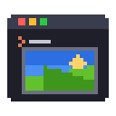
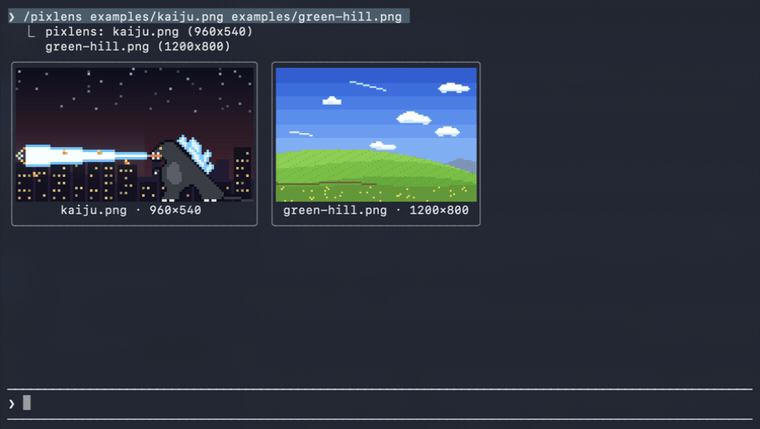
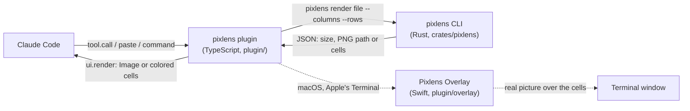

<a id="top"></a>

# Pixlens 
[](#license)
[](https://claude.com/claude-code)
[](crates/pixlens)
[](plugin)
[](plugin/overlay)
[](#terminal-support)

> See your images inside Claude Code, right in the terminal.
> 

Pasted pictures, charts your scripts draw and image files Claude reads show up
in the transcript, sharp even in Apple's Terminal. A small Rust CLI does the
image work and a Claude Code plugin draws the result.

**Contents:**
[Prerequisites](#prerequisites) ·
[Features](#features) ·
[Install](#install) ·
[Usage](#usage) ·
[Terminals](#terminal-support) ·
[How it works](#how-it-works) ·
[Built with](#built-with) ·
[FAQ](#faq)

<p align="center">
  
  <br><sub>Hover to light a picture up, click its name for the menu.</sub>
</p>

<p align="right"><a href="#top">back to top ↑</a></p>


## Prerequisites

- **Claude Code 2.1.295 or newer**, the first version with the function-hook plugin API. Check with `claude --version`.
- **Rust 1.88 or newer** to build the CLI with `cargo install`. Not needed if you download a prebuilt binary.
- **A terminal with color.** For sharp pictures:
  - Ghostty or kitty work as they are.
  - On macOS, Apple's Terminal (or herdr inside it) needs **Accessibility** access for that terminal, used by Pixlens Overlay.
- **Optional:** Python 3 with matplotlib, only to run `examples/chart.py`.

## Features

- **Paste thumbnails.** Paste an image and a thumbnail shows above the prompt, labelled `#1`, `#2`… instead of a bare `[Image #1]` tag. They go away when you send.
- **Automatic previews.** When Claude reads an image, writes one, or runs a script that makes one (`python plot.py` → `chart.png`), the picture appears right under that step.
- **Sharp, even in Apple's Terminal.** Real pixels in Ghostty and kitty; in Terminal.app and herdr the bundled [Pixlens Overlay](#pixlens-overlay-sharp-pictures-in-apples-terminal) lays the real picture over the preview.
- **Click to open.** Hover a picture or its name and it lights up. Click the picture to open it in Preview; click the name for a menu: Open in Preview, Quick Look, Copy Image, Show in Finder.
- **`/pixlens` command and `image_preview` tool.** Look at any image yourself, open or copy one, or let Claude show you a picture without reading it into its context.
- **Rust core.** Decoding, EXIF rotation, SVG rendering and resizing happen in a small, fast CLI. It also works on its own: `pixlens show photo.jpg` in any terminal.

Formats: PNG, JPEG, GIF (first frame), WebP, BMP, TIFF, ICO, QOI and SVG.

## Install

pixlens has two parts: the **`pixlens` CLI**, which decodes and resizes images, and the **Claude Code plugin**, which draws them. You need Claude Code 2.1.295 or newer (function hooks).

**1. The CLI**, from [crates.io](https://crates.io/crates/pixlens):

```sh
cargo install pixlens
```

Or one of these:

- **Prebuilt binary** for macOS, Linux or Windows from [Releases](https://github.com/z0nicx-d9/pixlens/releases): unpack it and put `pixlens` on your `PATH`. No Rust needed.
- **Latest from `main`**, before it is released:

  ```sh
  cargo install --git https://github.com/z0nicx-d9/pixlens
  ```

**2. The plugin**, typed at the Claude Code prompt:

```
/plugin install pixlens --marketplace z0nicx-d9/pixlens
```

Answer `y` to add the marketplace, then press Enter to install it for your user.

**3. On macOS with Apple's Terminal** (optional, for sharp pictures): give your terminal Accessibility access in **System Settings → Privacy & Security → Accessibility**. Add **Terminal**, or **herdr** if you run Claude Code inside herdr. See [Pixlens Overlay](#pixlens-overlay-sharp-pictures-in-apples-terminal).

<p align="right"><a href="#top">back to top ↑</a></p>

## Usage

Work as usual. Pictures show up on their own:

| You do | pixlens shows |
| --- | --- |
| Paste an image (ctrl+v, or cmd+v for a file copied in Finder) | A thumbnail above the prompt |
| Claude reads, writes or edits an image file | The picture under that step |
| Claude runs a script that saves an image | The new file under the `Bash` step (old files are left out, so `ls *.png` doesn't flood your screen) |
| Ask *"show me the chart"* | Claude calls `image_preview` and you see it |

Commands at the prompt:

```
/pixlens examples/kaiju.png examples/green-hill.png    # look at files yourself
/pixlens open #1                                         # open pasted image #1 in Preview
/pixlens copy chart.svg                                  # copy as a PNG, ready for ctrl+v
```

Try the example images:

```sh
cd pixlens && claude --plugin-dir ./plugin "/pixlens examples/kaiju.png examples/green-hill.png"
```

Outside Claude Code, the CLI is a viewer of its own:

```sh
pixlens show examples/kaiju.png                     # draw it in this terminal
pixlens show --protocol blocks --columns 60 photo.jpg
pixlens copy chart.svg                              # to the clipboard as a PNG
pixlens open photo.jpg                              # Preview on macOS, the default viewer elsewhere
```

<p align="right"><a href="#top">back to top ↑</a></p>

## Terminal support

| Terminal | Inside Claude Code | `pixlens show` |
| --- | --- | --- |
| Ghostty, kitty | real pixels | real pixels |
| Apple's Terminal, and herdr inside it (macOS) | real pixels, with Pixlens Overlay | colored blocks |
| iTerm2, WezTerm | colored blocks | real pixels |
| anything else with color, tmux included | colored blocks | colored blocks |

Colored blocks use quadrant glyphs (`▘▝▖▗▚▞▌▐▀▄…`): four dots a cell, with pixlens picking the two colors that lose the least. Click the name under a picture to see it full size.

<details>
<summary><b>herdr (or another multiplexer) inside Ghostty</b></summary>

Claude Code can't tell that the outer terminal draws images, so tell it, only when you are in Ghostty. Add this to `~/.zshrc`:

```sh
if [[ -n "$GHOSTTY_RESOURCES_DIR" ]]; then
  export CLAUDE_CODE_FORCE_TERMINAL_IMAGES=1
fi
```

pixlens reads the same variable.
</details>

### Pixlens Overlay: sharp pictures in Apple's Terminal

Apple's Terminal can't draw pixels, and a plugin can only draw characters there. So the plugin ships a small macOS helper, `plugin/overlay/Pixlens Overlay.app`, that lays the real picture over each preview. Nothing to install: the plugin starts it from its own folder the first time it draws a picture.

- It needs **Accessibility** access for your terminal (Terminal, or herdr) to find where each picture is on screen. Without it, previews stay colored blocks.
- Pictures follow scrolling, redraws and window drags, show whenever their Terminal window is visible, and are cut where another window or a pane edge covers them.
- Clicks pass through to the terminal. The overlay lights the picture or name under the pointer, opens a clicked picture in Preview, and shows the menu for a clicked name.
- It runs in the background as `pixlens-overlay` (no Dock icon). Turn it off with the `overlay` setting.

<p align="right"><a href="#top">back to top ↑</a></p>

## Settings

Change these in `/config`, under pixlens:

| Setting | Default | What it does |
| --- | --- | --- |
| `binary` | `pixlens` | Path to the CLI, if it is not on `PATH` |
| `mode` | `auto` | `image` (real pixels), `blocks` (colored blocks) or `auto` (picked from your terminal) |
| `glyphs` | `quad` | `quad` (four dots a cell, sharper) or `half` (two, for fonts that draw quadrants with gaps) |
| `maxColumns` / `maxRows` | 32 / 9 | Largest preview under a tool step, in terminal cells |
| `thumbRows` | 3 | Height of paste thumbnails, in rows |
| `pasteThumbnails` | on | Show pasted images above the prompt |
| `automatic` | on | Show previews under tool steps |
| `tool` | on | Give Claude the `image_preview` tool |
| `overlay` | on | On macOS, start Pixlens Overlay for sharp pictures in Apple's Terminal |

<p align="right"><a href="#top">back to top ↑</a></p>

## How it works



1. **Find the image.** The plugin hooks Claude Code's tool calls (`Read`, `Write`, `Edit`, `Bash`), the `/pixlens` command and the draft: a paste saves the image to the session's temp folder and puts `[Image #n]` in the prompt, which the plugin reads every 250 ms.
2. **Fit it.** The Rust CLI decodes the file, applies EXIF rotation (SVG through `resvg`), fits it to a box of terminal cells and answers JSON: a resized PNG for pixel terminals, or two-color quadrant cells for the rest.
3. **Draw it.** The plugin draws Claude Code's `Image` element where the terminal speaks the kitty graphics protocol, and colored text otherwise.
4. **Sharpen it (Apple's Terminal).** Each picture carries a tag of four braille cells. Pixlens Overlay reads the terminal's text through the Accessibility API, finds the tags, and puts a borderless window holding the real image exactly over the picture's cells.

Resized PNGs live in the platform cache folder (`PIXLENS_CACHE_DIR` overrides it) and are deleted after 14 days.

<p align="right"><a href="#top">back to top ↑</a></p>


Main Rust crates:

| Crate | Version | Used for |
| --- | --- | --- |
| [`image`](https://crates.io/crates/image) | 0.25 | Decoding PNG, JPEG, GIF, WebP, BMP, TIFF, ICO and QOI, resizing |
| [`resvg`](https://crates.io/crates/resvg) | 0.48 | Rendering SVG |
| [`clap`](https://crates.io/crates/clap) | 4.6 | Command-line arguments |
| [`serde_json`](https://crates.io/crates/serde_json) | 1.0 | The JSON the plugin reads |
| [`terminal_size`](https://crates.io/crates/terminal_size) | 0.4 | Fitting `pixlens show` to the window |

<p align="right"><a href="#top">back to top ↑</a></p>

## FAQ

<details>
<summary><b>The pictures are blurry blocks in Terminal.app.</b></summary>

Pixlens Overlay isn't drawing. Check with:

```sh
pixlens overlay --app "<plugin folder>/overlay/Pixlens Overlay.app"
```

You want `"ready":true`. `false` means your terminal (Terminal, or herdr) has no Accessibility access yet.
</details>

<details>
<summary><b>Why is there a background app at all? Isn't this a plugin?</b></summary>

A Claude Code plugin can only draw characters in Apple's Terminal. Showing real pixels there means putting a window on screen, which only an app can do. It ships inside the plugin and the plugin starts it, so there is nothing extra to install. On Ghostty or kitty it isn't used.
</details>

<details>
<summary><b>Does Claude see the images pixlens shows?</b></summary>

No. Previews are for you. `image_preview` tells Claude only the file names and sizes; Claude uses `Read` when it needs to look at an image itself.
</details>

<p align="right"><a href="#top">back to top ↑</a></p>

## Contributing

Issues and pull requests are welcome. To work on it:

```sh
cargo test                      # the CLI
claude plugin validate .        # marketplace, manifest and hooks module
claude plugin test plugin       # the plugin's tests
plugin/overlay/build.sh         # rebuild Pixlens Overlay after changing its Swift source
claude --plugin-dir ./plugin    # a session with your working copy loaded
```

`claude --plugin-dir` reloads the plugin whenever you save a file in it.

**Limits.** The function-hook API is early access, so a future Claude Code release may need changes here; CI pins the version last checked. Previews show in the terminal only, not in the desktop app or the VS Code extension. tmux doesn't pass graphics through.

## License

Licensed under either of [Apache License, Version 2.0](LICENSE-APACHE) or [MIT license](LICENSE-MIT) at your option.

Unless you explicitly state otherwise, any contribution you intentionally submit for inclusion in this project, as defined in the Apache-2.0 license, is dual licensed as above, without any additional terms or conditions.

The example images in `examples/` were drawn for this project and are under the same licenses.

<p align="right"><a href="#top">back to top ↑</a></p>
