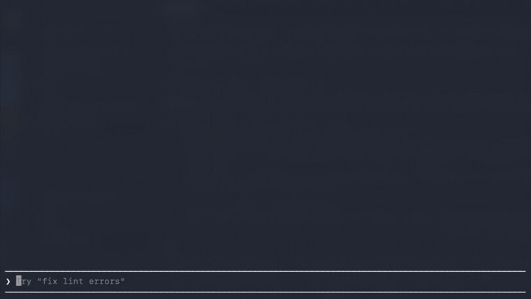
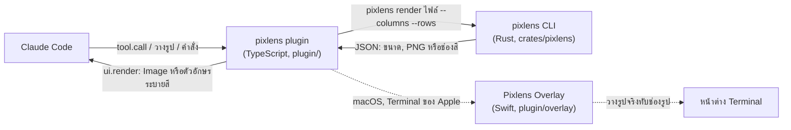

<a id="top"></a>

<div align="center">

# pixlens

**ดูรูปได้ตรงใน [Claude Code](https://claude.com/claude-code)**<br>
รูปที่วาง กราฟที่สคริปต์วาด ไฟล์ที่ Claude เปิดอ่าน แสดงใน terminal ได้เลย และคมด้วย

[](https://github.com/OWNER/pixlens/actions/workflows/ci.yml)
[](#license)
[](crates/pixlens)
[](https://claude.com/claude-code)



[ความสามารถ](#features) ·
[ติดตั้ง](#install) ·
[วิธีใช้](#usage) ·
[Terminal](#terminal-support) ·
[ทำงานยังไง](#how-it-works) ·
[คำถามที่พบบ่อย](#faq) ·
[English](README.md)

</div>

---

<a id="features"></a>

## ความสามารถ

- 🖼️ **รูปย่อของรูปที่วาง**: วางรูปแล้วจะมีรูปย่อขึ้นเหนือช่องพิมพ์ มีเลข `#1`, `#2`… กำกับ แทนที่จะเห็นแค่ `[Image #1]` หายไปเองเมื่อส่งข้อความ
- ⚡ **แสดงอัตโนมัติ**: เวลา Claude เปิดอ่านรูป เขียนไฟล์รูป หรือรันสคริปต์ที่สร้างรูป (`python plot.py` → `chart.png`) รูปจะขึ้นใต้ขั้นตอนนั้นเลย
- 🔍 **คมแม้ใน Terminal ของ Apple**: Ghostty กับ kitty ได้รูปจริงระดับ pixel ส่วน Terminal.app และ herdr ใช้ [Pixlens Overlay](#overlay) ที่มากับ plugin วางรูปจริงทับช่องรูป
- 🖱️ **คลิกเพื่อเปิด**: เอาเมาส์ชี้ที่รูปหรือชื่อจะขึ้นไฮไลต์ คลิกรูปเพื่อเปิดใน Preview คลิกชื่อเพื่อเปิดเมนู Open in Preview, Quick Look, Copy Image, Show in Finder
- 💬 **คำสั่ง `/pixlens` และ tool `image_preview`**: เปิดดูรูปไหนก็ได้เอง เปิดหรือคัดลอกรูป หรือให้ Claude โชว์รูปให้ดูโดยไม่ต้องอ่านรูปเข้าไปเอง
- 🦀 **แกนหลักเป็น Rust**: การอ่านไฟล์ หมุนรูปตาม EXIF วาด SVG และย่อรูป ทำใน CLI เล็ก ๆ ที่เร็ว และใช้แยกเองได้ด้วย เช่น `pixlens show photo.jpg` ใน terminal ไหนก็ได้

รองรับ PNG, JPEG, GIF (เฟรมแรก), WebP, BMP, TIFF, ICO, QOI และ SVG

<p align="center">
  
  <br><sub>ชี้ที่รูปเพื่อไฮไลต์ คลิกชื่อเพื่อเปิดเมนู</sub>
</p>

<p align="right"><a href="#top">กลับขึ้นบน ↑</a></p>

<a id="install"></a>

## ติดตั้ง

pixlens มีสองส่วน คือ **CLI `pixlens`** ที่อ่านและย่อรูป กับ **plugin ของ Claude Code** ที่วาดรูป ต้องใช้ Claude Code 2.1.295 ขึ้นไป (ที่มีระบบ function hook)

**1. CLI**

```sh
cargo install --git https://github.com/OWNER/pixlens pixlens
```

หรือดาวน์โหลด binary ที่ build แล้วจาก [Releases](https://github.com/OWNER/pixlens/releases) แล้ววางไว้ใน `PATH`

**2. plugin** พิมพ์ในช่อง prompt ของ Claude Code:

```
/plugin install pixlens --marketplace OWNER/pixlens
```

ตอบ `y` เพื่อเพิ่ม marketplace แล้วกด Enter เพื่อติดตั้งให้ผู้ใช้ของคุณ

**3. บน macOS ที่ใช้ Terminal ของ Apple** (ไม่บังคับ ใช้เพื่อให้รูปคม): เปิดสิทธิ์ Accessibility ให้ terminal ใน **System Settings → Privacy & Security → Accessibility** ให้ **Terminal** หรือ **herdr** ถ้ารัน Claude Code ใน herdr ดูเพิ่มที่ [Pixlens Overlay](#overlay)

<p align="right"><a href="#top">กลับขึ้นบน ↑</a></p>

<a id="usage"></a>

## วิธีใช้

ใช้งานตามปกติ รูปจะขึ้นเอง:

| คุณทำ | pixlens แสดง |
| --- | --- |
| วางรูป (ctrl+v หรือ cmd+v ถ้าเป็นไฟล์ที่ copy จาก Finder) | รูปย่อเหนือช่องพิมพ์ |
| Claude เปิดอ่าน เขียน หรือแก้ไฟล์รูป | รูปใต้ขั้นตอนนั้น |
| Claude รันสคริปต์ที่บันทึกรูป | ไฟล์ใหม่ใต้ขั้นตอน `Bash` (ไฟล์เก่าไม่แสดง สั่ง `ls *.png` จะได้ไม่มีรูปเต็มจอ) |
| ขอว่า *"show me the chart"* | Claude เรียก `image_preview` แล้วรูปขึ้นให้ดู |

คำสั่งในช่องพิมพ์:

```
/pixlens examples/kaiju.png examples/green-hill.png    # เปิดดูรูปเอง
/pixlens open #1                                         # เปิดรูปที่วาง #1 ใน Preview
/pixlens copy chart.svg                                  # คัดลอกเป็น PNG พร้อมวางด้วย ctrl+v
```

ลองกับรูปตัวอย่าง:

```sh
cd pixlens && claude --plugin-dir ./plugin "/pixlens examples/kaiju.png examples/green-hill.png"
```

นอก Claude Code ตัว CLI ใช้ดูรูปได้เอง:

```sh
pixlens show examples/kaiju.png                     # วาดรูปใน terminal นี้
pixlens show --protocol blocks --columns 60 photo.jpg
pixlens copy chart.svg                              # คัดลอกลง clipboard เป็น PNG
pixlens open photo.jpg                              # เปิดใน Preview (macOS) หรือโปรแกรมดูรูปที่ตั้งไว้
```

<p align="right"><a href="#top">กลับขึ้นบน ↑</a></p>

<a id="terminal-support"></a>

## Terminal ที่รองรับ

| Terminal | ใน Claude Code | `pixlens show` |
| --- | --- | --- |
| Ghostty, kitty | ✅ รูปจริง | ✅ รูปจริง |
| Terminal ของ Apple และ herdr ที่รันข้างใน (macOS) | ✅ รูปจริง ด้วย Pixlens Overlay | ตัวอักษรระบายสี |
| iTerm2, WezTerm | ตัวอักษรระบายสี | ✅ รูปจริง |
| terminal อื่นที่มีสี รวมถึง tmux | ตัวอักษรระบายสี | ตัวอักษรระบายสี |

ตัวอักษรระบายสีใช้ตัว quadrant (`▘▝▖▗▚▞▌▐▀▄…`) ได้ช่องละ 4 จุด pixlens เลือกสองสีที่เสียรายละเอียดน้อยที่สุด ถ้าอยากดูเต็ม ๆ คลิกชื่อใต้รูป

<details>
<summary><b>herdr (หรือ multiplexer อื่น) ที่รันใน Ghostty</b></summary>

Claude Code ไม่รู้ว่า terminal ชั้นนอกวาดรูปได้ ต้องบอกเอง ให้มีผลเฉพาะตอนอยู่ใน Ghostty โดยเพิ่มใน `~/.zshrc`:

```sh
if [[ -n "$GHOSTTY_RESOURCES_DIR" ]]; then
  export CLAUDE_CODE_FORCE_TERMINAL_IMAGES=1
fi
```

pixlens อ่านค่านี้ด้วย
</details>

<a id="overlay"></a>

### Pixlens Overlay: รูปคมใน Terminal ของ Apple

Terminal ของ Apple วาด pixel ไม่ได้ และ plugin วาดได้แค่ตัวอักษร plugin จึงมีตัวช่วยเล็ก ๆ บน macOS ติดมาด้วย (`plugin/overlay/Pixlens Overlay.app`) คอยวางรูปจริงทับช่องรูป ไม่ต้องติดตั้งเพิ่ม plugin เปิดให้เองจากโฟลเดอร์ของมันตอนวาดรูปครั้งแรก

- ต้องเปิดสิทธิ์ **Accessibility** ให้ terminal (Terminal หรือ herdr) เพื่อหาว่ารูปอยู่ตรงไหนบนจอ ถ้าไม่มีสิทธิ์ รูปจะเป็นตัวอักษรระบายสี
- รูปตามการเลื่อนจอ การวาดจอใหม่ และการลากหน้าต่าง แสดงตลอดที่มองเห็นหน้าต่าง Terminal และถูกตัดตรงที่มีหน้าต่างอื่นหรือขอบ pane บังอยู่
- คลิกทะลุลงไปที่ terminal ได้ ตัวช่วยจะไฮไลต์รูปหรือชื่อที่เมาส์ชี้ คลิกรูปเปิดใน Preview คลิกชื่อเปิดเมนู
- รันอยู่ข้างหลังในชื่อ `pixlens-overlay` (ไม่มีไอคอนใน Dock) ปิดได้ที่ setting `overlay`

<p align="right"><a href="#top">กลับขึ้นบน ↑</a></p>

## ตั้งค่า

เปลี่ยนได้ใน `/config` หัวข้อ pixlens:

| Setting | ค่าเริ่มต้น | ใช้ทำอะไร |
| --- | --- | --- |
| `binary` | `pixlens` | ที่อยู่ของ CLI ถ้าไม่ได้อยู่ใน `PATH` |
| `mode` | `auto` | `image` (รูปจริง), `blocks` (ตัวอักษรระบายสี) หรือ `auto` (เลือกตาม terminal) |
| `glyphs` | `quad` | `quad` (ช่องละ 4 จุด คมกว่า) หรือ `half` (ช่องละ 2 จุด สำหรับ font ที่วาด quadrant มีช่องว่าง) |
| `maxColumns` / `maxRows` | 32 / 9 | ขนาดใหญ่สุดของรูปใต้ขั้นตอนของ tool หน่วยเป็นช่อง |
| `thumbRows` | 3 | ความสูงของรูปย่อตอนวาง หน่วยเป็นบรรทัด |
| `pasteThumbnails` | เปิด | แสดงรูปที่วางเหนือช่องพิมพ์ |
| `automatic` | เปิด | แสดงรูปใต้ขั้นตอนของ tool |
| `tool` | เปิด | ให้ Claude ใช้ tool `image_preview` ได้ |
| `overlay` | เปิด | บน macOS เปิด Pixlens Overlay ให้รูปคมใน Terminal ของ Apple |

<p align="right"><a href="#top">กลับขึ้นบน ↑</a></p>

<a id="how-it-works"></a>

## ทำงานยังไง



1. **หารูป**: plugin ดักการเรียก tool ของ Claude Code (`Read`, `Write`, `Edit`, `Bash`), คำสั่ง `/pixlens` และข้อความในช่องพิมพ์ ตอนวางรูป Claude Code บันทึกรูปไว้ในโฟลเดอร์ชั่วคราวของ session แล้วใส่ `[Image #n]` ในช่องพิมพ์ plugin อ่านช่องพิมพ์ทุก 250 ms
2. **ย่อรูป**: CLI ภาษา Rust อ่านไฟล์ หมุนตาม EXIF (SVG ใช้ `resvg`) ย่อให้พอดีกับจำนวนช่อง แล้วตอบเป็น JSON: PNG ที่ย่อแล้วสำหรับ terminal ที่วาด pixel ได้ หรือช่องสี quadrant สองสีสำหรับ terminal อื่น
3. **วาดรูป**: plugin ใช้ element `Image` ของ Claude Code กับ terminal ที่รองรับ kitty graphics และใช้ตัวอักษรระบายสีกับ terminal อื่น
4. **ทำให้คม (Terminal ของ Apple)**: ทุกรูปมีป้ายอักษรเบรลล์ 4 ช่อง Pixlens Overlay อ่านข้อความบนจอผ่าน Accessibility หาป้ายเจอแล้ววางหน้าต่างรูปจริงแบบไม่มีกรอบทับช่องรูปพอดี

รูปที่ย่อแล้วเก็บไว้ในโฟลเดอร์ cache ของระบบ (เปลี่ยนได้ด้วย `PIXLENS_CACHE_DIR`) และลบทิ้งเองหลัง 14 วัน

<p align="right"><a href="#top">กลับขึ้นบน ↑</a></p>

<a id="faq"></a>

## คำถามที่พบบ่อย

<details>
<summary><b>ใน Terminal.app รูปเป็นตัวอักษรเบลอ ๆ</b></summary>

แปลว่า Pixlens Overlay ยังไม่ได้วาด เช็กด้วย:

```sh
pixlens overlay --app "<โฟลเดอร์ plugin>/overlay/Pixlens Overlay.app"
```

ต้องได้ `"ready":true` ถ้าได้ `false` แปลว่า terminal (Terminal หรือ herdr) ยังไม่ได้สิทธิ์ Accessibility
</details>

<details>
<summary><b>ทำไมต้องมีแอปรันอยู่ข้างหลัง เป็น plugin ไม่ใช่เหรอ</b></summary>

plugin ของ Claude Code วาดได้แค่ตัวอักษรใน Terminal ของ Apple การจะแสดงรูปจริงต้องเปิดหน้าต่างบนจอ ซึ่งต้องเป็นแอปเท่านั้น ตัวแอปมากับ plugin และ plugin เปิดให้เอง ไม่ต้องติดตั้งอะไรเพิ่ม ถ้าใช้ Ghostty หรือ kitty จะไม่ได้ใช้แอปนี้
</details>

<details>
<summary><b>กด cmd+v แล้ววาง screenshot ไม่ได้</b></summary>

ถ้าใน clipboard เป็นข้อมูลรูป (เช่น screenshot) ให้กด **ctrl+v** ซึ่งเป็นการวางรูปของ Claude Code เอง ส่วน cmd+v เป็นของแอป terminal ซึ่งส่งต่อได้แค่ข้อความ หรือ path ของไฟล์ถ้า copy ไฟล์มาจาก Finder
</details>

<details>
<summary><b>Claude เห็นรูปที่ pixlens แสดงไหม</b></summary>

ไม่เห็น รูปที่แสดงมีไว้ให้คุณดู `image_preview` บอก Claude แค่ชื่อไฟล์กับขนาด ถ้า Claude ต้องดูรูปเอง จะใช้ `Read`
</details>

<p align="right"><a href="#top">กลับขึ้นบน ↑</a></p>

## ร่วมพัฒนา

ส่ง issue และ pull request มาได้เลย คำสั่งที่ใช้ตอนพัฒนา:

```sh
cargo test                      # ทดสอบ CLI
claude plugin validate .        # ตรวจ marketplace, manifest และ hooks module
claude plugin test plugin       # ทดสอบ plugin
plugin/overlay/build.sh         # build Pixlens Overlay ใหม่หลังแก้โค้ด Swift
claude --plugin-dir ./plugin    # เปิด session ที่โหลด plugin จากโฟลเดอร์นี้
```

`claude --plugin-dir` โหลด plugin ใหม่ทุกครั้งที่บันทึกไฟล์

**ข้อจำกัด**: ระบบ function hook ยังเป็น early access Claude Code เวอร์ชันหลัง ๆ อาจต้องแก้ตาม CI จึงล็อกเวอร์ชันที่เช็กล่าสุดไว้ รูปแสดงได้เฉพาะใน terminal ไม่แสดงในแอป desktop หรือ VS Code extension และ tmux ไม่ส่งรูปต่อ

<a id="license"></a>

## License

ใช้ได้ภายใต้ [Apache License, Version 2.0](LICENSE-APACHE) หรือ [MIT license](LICENSE-MIT) เลือกได้ตามสะดวก

ผลงานที่คุณส่งมาร่วมในโปรเจกต์นี้ ถ้าไม่ได้ระบุไว้เป็นอย่างอื่น จะใช้ทั้งสอง license ข้างต้นตามนิยามใน Apache-2.0 โดยไม่มีเงื่อนไขเพิ่ม

รูปตัวอย่างใน `examples/` วาดขึ้นสำหรับโปรเจกต์นี้ และใช้ license เดียวกัน

<p align="right"><a href="#top">กลับขึ้นบน ↑</a></p>
